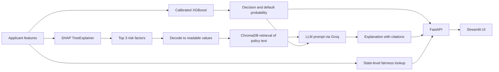

<div align="center">

# Explainable Credit Risk Prediction

**Calibrated default-risk model · SHAP explanations · fairness audit · policy-grounded LLM explanations**


</div>

An end-to-end data science project built on 2.26M real LendingClub loans. It predicts whether a borrower will default, explains each decision with SHAP, audits the model for group-level disparities, and uses retrieval-augmented generation (RAG) to write a plain-English explanation grounded in lending policy text, with citations.

> **Status:** runs locally (FastAPI backend + Streamlit frontend). Not deployed yet.
> <!-- When deployed, add: **Live demo:** <link> -->

<!-- Add 1-2 screenshots here, for example:  -->

---

## Highlights

| | |
|---|---|
| **Data** | 2,260,701 raw loans, 151 columns, narrowed to 1,345,489 loans with a known outcome and 60 model features |
| **Model** | XGBoost, class-weighted: **ROC-AUC 0.733** (logistic regression baseline: 0.717) |
| **Calibration** | Platt scaling fixed a clearly overconfident reliability curve |
| **Explainability** | Per-applicant SHAP top factors, decoded into human-readable values |
| **Fairness** | State-level proxy audit: disparate impact ratio **0.688** (IL vs NY), mitigation tested and rejected |
| **RAG** | ChromaDB retrieval over 6 policy documents, LLM output with `[Source: ...]` citations |
| **Engineering** | FastAPI backend, Streamlit UI, reproducible small deployment bundle |

## Table of contents

- [Overview](#overview)
- [Features](#features)
- [Architecture](#architecture)
- [Tech stack](#tech-stack)
- [Data and preprocessing](#data-and-preprocessing)
- [Modeling and results](#modeling-and-results)
- [Explainability](#explainability)
- [RAG explanation pipeline](#rag-explanation-pipeline)
- [Fairness audit](#fairness-audit)
- [API reference](#api-reference)
- [Getting started](#getting-started)
- [Project structure](#project-structure)
- [Limitations and future work](#limitations-and-future-work)

## Overview

Lenders use ML models to approve or reject loans, and that raises three problems:

1. **Opacity.** Accurate models such as gradient boosting are hard to interpret.
2. **A legal duty to explain.** Under ECOA / Regulation B, a denied applicant must be given the specific reasons. Writing these by hand is slow and inconsistent.
3. **Bias risk.** Models can disadvantage groups through proxy features even when protected attributes are not used.

This project addresses all three: a calibrated risk model, per-applicant explanations, and a fairness audit, delivered through an API and a small web app.

## Features

- Default probability and an approved / denied decision for each applicant
- Top 3 risk factors with direction (increases or decreases risk) and magnitude
- Plain-English explanation grounded in retrieved policy documents, with citations
- Expandable view of the exact policy text the explanation was based on
- State-level fairness context drawn from the audit in this repo
- REST API with interactive docs

## Architecture



## Tech stack

| Layer | Tools |
|---|---|
| Language | Python 3.12 |
| Data processing | pandas 3.0, NumPy 2.5 |
| Modeling | XGBoost 3.4, scikit-learn 1.9 (logistic regression baseline, `RandomizedSearchCV`, probability calibration), joblib |
| Explainability | SHAP 0.52 (`TreeExplainer`) |
| Fairness | Fairlearn (`MetricFrame`, `ThresholdOptimizer`) |
| Retrieval (RAG) | ChromaDB 1.5 with its default `all-MiniLM-L6-v2` embeddings |
| LLM | Groq API (`openai/gpt-oss-20b`), `groq` Python SDK |
| Backend | FastAPI 0.142, Uvicorn 0.54 |
| Frontend | Streamlit, Requests |
| Analysis and visualization | Jupyter notebooks, matplotlib, seaborn |
| Configuration | python-dotenv (`.env` for the API key) |
| Tooling | Git, GitHub, VS Code |

## Data and preprocessing

**Source:** LendingClub accepted loans, 2007-2018 (Kaggle, "All Lending Club loan data").

| Stage | Rows | Columns |
|---|---|---|
| Raw | 2,260,701 | 151 |
| Loans with a final outcome | 1,348,099 | 48 selected |
| After cleaning | 1,345,489 | 60 model features after encoding |
| Train / test (stratified 80/20) | 1,076,391 / 269,098 | |

**Target.** `Fully Paid` is 0. `Charged Off` and `Default` are 1, including the "does not meet the credit policy" variants. Loans that are `Current`, `Late` or `In Grace Period` were dropped because their outcome is not known yet. About 20% of loans default.

**Feature selection.** Columns were dropped for three reasons: more than 40% missing values, data leakage (payment and recovery fields that exist only after the loan is issued), or being an identifier or free text.

**Cleaning and encoding**

- `term` and `emp_length` converted to numbers; missing `emp_length` kept as its own category (-1)
- Median fill for credit-bureau numerics with 3-5% missing; rows dropped where under 0.1% was missing
- Engineered feature: `credit_history_years` from `issue_d` and `earliest_cr_line`
- `grade` and `sub_grade`: ordinal. `home_ownership`, `verification_status`, `purpose`: one-hot. `addr_state`: frequency encoding. `zip_code`: dropped (945 categories, mostly covered by state)

## Modeling and results

Class imbalance (about 80/20) is handled with class weights (`class_weight='balanced'`, and `scale_pos_weight` of about 4.0 for XGBoost) rather than SMOTE, because the minority class already has over 250,000 real examples.

| Model | ROC-AUC | Default precision | Default recall | Default F1 |
|---|---|---|---|---|
| Logistic regression (scaled, class-weighted) | 0.717 | 0.33 | 0.65 | 0.43 |
| **XGBoost (selected)** | **0.733** | 0.33 | 0.68 | 0.44 |
| XGBoost after random search (15 candidates, 150k-row sample) | 0.724 | 0.32 | 0.68 | 0.44 |

Precision, recall and F1 are at a 0.5 threshold on the raw class-weighted scores, on the held-out test set. Random search scored lower than the original settings, so the original model was kept.

**Calibration.** Class weighting inflates predicted probabilities. The reliability curve was clearly overconfident (a predicted 0.65 matched roughly 0.32 observed). Platt scaling (`CalibratedClassifierCV`, sigmoid) brought it close to the diagonal. ROC-AUC is unchanged, because the transform is monotonic.

## Explainability

SHAP `TreeExplainer` is applied to the underlying XGBoost model. `explainability.py` ranks each applicant's SHAP contributions and returns the top N, and `decoding.py` turns encoded values back into readable ones (for example, sub-grade `0` becomes `A1`).

## RAG explanation pipeline

1. Take the applicant's top SHAP features and decode them.
2. Query ChromaDB over six policy documents in `policy_docs/` (credit grade, debt-to-income, credit history, loan terms, income verification, adverse action requirements).
3. Prompt the LLM with the decision, the probability, each factor labeled "INCREASES risk" or "DECREASES risk", and the retrieved text labeled by source.
4. Require citations in the form `[Source: document_name]`.

The ChromaDB index is rebuilt from `policy_docs/` automatically if it is empty, so a fresh clone works without extra steps.

**Failure modes found in testing and fixed**

| Problem | Cause | Fix |
|---|---|---|
| The LLM invented a credit tier range for `sub_grade = 14` | It was given an encoded number with no meaning attached | Decode values before prompting |
| For sub-grade B2 with a negative SHAP value, the LLM said it raised default likelihood | It reasoned about direction from general assumptions | Pre-label each factor's direction and instruct the model to use it verbatim |

This checking was manual, on a handful of applicants. It is not a systematic evaluation.

## Fairness audit

The dataset has no race, gender or age, so the audit uses **`addr_state` as a geographic proxy**, on the five largest states in the test set. The full write-up is in [`fairness_report.md`](fairness_report.md).

| State | Flagged high-risk | True positive rate | False positive rate |
|---|---|---|---|
| IL | 2.92% | 0.092 | 0.015 |
| TX | 3.40% | 0.093 | 0.019 |
| CA | 3.65% | 0.111 | 0.018 |
| FL | 3.94% | 0.103 | 0.021 |
| NY | 4.24% | 0.114 | 0.022 |

- **Disparate impact ratio (IL / NY): 0.688**, below the 0.80 four-fifths rule of thumb.
- New York is flagged more often and Illinois less often, in both correct and incorrect flags. The pattern is systematic rather than random, and the data cannot separate genuine risk differences from model bias.
- **Mitigation tried:** Fairlearn `ThresholdOptimizer` with an equalized-odds constraint. It brought state-level true positive rates to 0.071-0.073, but lowered overall default recall to 0.07 (precision 0.55). It was not adopted.

These figures are for the calibrated model's hard decisions at a 0.5 threshold. The fairness note shown in the app is a lookup of these audit findings by the applicant's state. It is context, not a per-applicant bias detector.

## API reference

| Endpoint | Description |
|---|---|
| `GET /` | Health check |
| `GET /applicant/{index}` | Decision, probability, top factors, explanation, sources |
| `GET /fairness-check/{index}` | State-level audit context for the applicant |

Interactive docs are served at `/docs`. The demo pool is the first 300 rows of the held-out test set (indices 0-299).

Example response from `GET /applicant/48` (shortened):

```json
{
  "decision": "APPROVED",
  "probability": 0.0277,
  "top_reasons": [
    { "feature": "sub_grade", "decoded_value": "A1", "shap_contribution": -0.853, "direction": "DECREASES risk" },
    { "feature": "grade", "decoded_value": "A", "shap_contribution": -0.477, "direction": "DECREASES risk" },
    { "feature": "fico_range_low", "decoded_value": 795, "shap_contribution": -0.442, "direction": "DECREASES risk" }
  ],
  "sources_used": ["credit_grade", "credit_history"],
  "explanation": "Your application has been approved ... [Source: credit_grade] ..."
}
```

## Getting started

**Prerequisites:** Python 3.12 and a free [Groq API key](https://console.groq.com).

```bash
git clone https://github.com/Uday955/credit-risk-rag-api.git
cd credit-risk-rag-api

python -m venv .venv
.venv\Scripts\activate            # Windows (macOS/Linux: source .venv/bin/activate)
pip install -r requirements.txt
pip install streamlit requests    # frontend only
```

Create a `.env` file in the project root:

```
GROQ_API_KEY=your_key_here
```

Run the backend, then the frontend in a second terminal:

```bash
uvicorn api:app --reload
streamlit run app.py
```

On first start, the policy index is built automatically and ChromaDB downloads its embedding model (about 80 MB). Pinned library versions in `requirements.txt` matter: the saved model was trained with them.

### Reproducing the training

The raw data is not in this repo. Download `accepted_2007_to_2018Q4.csv` from Kaggle into `data/raw/`, then run the notebooks in order (`1eda` to `6rag`). `prepare_deployment_data.py` regenerates the small files in `deploy_data/`.

## Project structure

```
api.py                      FastAPI backend
app.py                      Streamlit frontend
rag_pipeline.py             ChromaDB retrieval, prompt building, Groq call
explainability.py           SHAP top-reasons helper
decoding.py                 Encoded value -> readable value
prepare_deployment_data.py  Builds deploy_data/ from the full dataset
models/                     Trained, calibrated XGBoost model
deploy_data/                300-applicant demo pool and state decoder
policy_docs/                Lending policy documents (RAG knowledge base)
fairness_report.md          Full fairness audit write-up
1eda ... 6rag .ipynb        Analysis notebooks, one per stage
requirements.txt            Pinned backend dependencies
```

## Limitations and future work

**Limitations**

- **Illustrative policy documents.** The six policy files were written for this project from public ECOA / Regulation B concepts. They are not a real lender's underwriting policy.
- **Preprocessing before the split.** Medians and the `addr_state` frequency encoding were computed on the full dataset before splitting. With over a million rows the effect is likely small, but it is a mild leak.
- **Random split, not temporal.** LendingClub data spans years. A production check would validate on later periods.
- **Calibration and fairness mitigation were fitted on the test set** for simplicity. A separate holdout would be cleaner.
- **Decision threshold.** The deployed decision is the calibrated model at 0.5. With a base default rate near 20%, this flags only about 3-4% of applicants, with a true positive rate near 0.10. The recall of 0.68 in the results table belongs to the uncalibrated, class-weighted model. A lender would choose the threshold from business costs.
- **SHAP explains the uncalibrated model.** Attributions describe the raw model, while the displayed probability is calibrated.
- **Proxy fairness audit.** State is an imperfect stand-in for protected attributes, and the audit covers one proxy and five states.
- **LLM output** was checked manually on a small sample, not benchmarked.

**Future work**

- Temporal validation and a cost-based decision threshold
- In-processing fairness methods (for example, Fairlearn `ExponentiatedGradient`) and a separate holdout for calibration and mitigation
- A systematic evaluation of explanation faithfulness and citation accuracy
- A form for entering a new applicant instead of selecting from the demo pool
- Cloud deployment of the API and the frontend

## Disclaimer

This is an educational project. It is not a credit decisioning system and should not be used to make real lending decisions.

## Author

[Uday955](https://github.com/Uday955)

